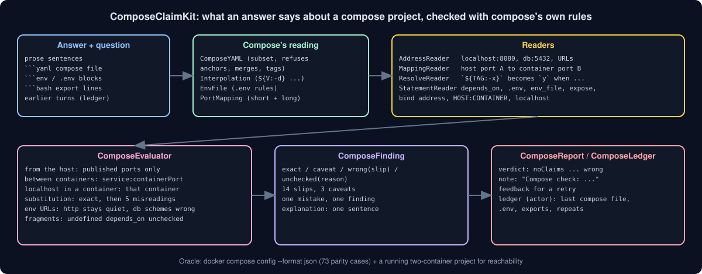
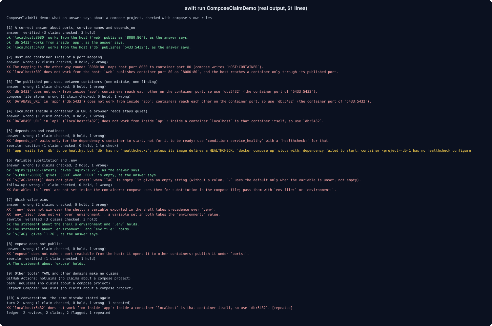
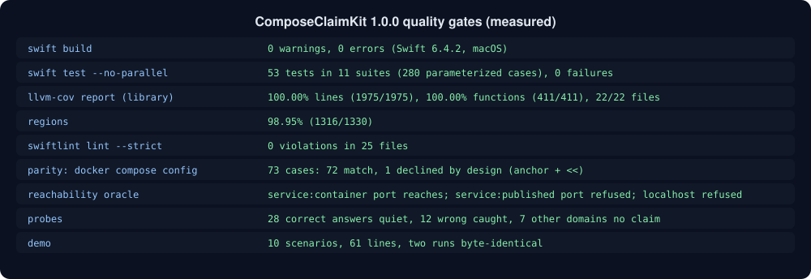

# ComposeClaimKit



ComposeClaimKit reads what an LLM answer says about a Docker Compose project and checks it against the rules
compose and Docker actually follow. It covers which port is reachable from where, what a `${VAR}` substitution
gives, which variable source wins, and what `depends_on` waits for. It also reads the answer's compose file for
addresses that cannot work.

It is the next package in a Swift series built around
[ProviderGatewayKit](https://github.com/rajatslakhina/foundation-model-provider-gateway). Earlier packages check
what an answer says about a Dockerfile ([DockerfileClaimKit](https://github.com/rajatslakhina/dockerfile-claim-kit))
and what a container runs ([EntrypointClaimKit](https://github.com/rajatslakhina/entrypoint-claim-kit)). This one
moves up to the compose file that runs those containers together.

## Why

Compose mistakes don't fail when you write the file. `docker compose config` accepts them, and they show up later as
a refused connection or an empty variable:

- `DATABASE_URL=postgres://db:5433/app` when `db` publishes `5433:5432`. Containers reach each other on the
  container port, so `db:5433` is refused. Run against a real project, `db:5432` answered and `db:5433` gave
  `Connection refused`.
- `localhost:5432` used inside the `api` container to reach Postgres. Inside a container, `localhost` is that
  container.
- "`depends_on` makes sure the database is ready." It waits only for the container to start.
- "`${TAG-latest}` gives `latest` when `TAG` is empty." Without a colon, the default applies only when `TAG` is unset.
- "Variables in `.env` are available inside the container." Compose uses `.env` for substitution in the compose file
  only.

Each of these reads as fluent, confident advice. A reader can't tell from the text that it's wrong.

## What it checks

| Claim | Example | Judged by |
|---|---|---|
| Address from the host | "open `http://localhost:8080`" | a published port on a loopback or all-interfaces address |
| Address between containers | "`app` connects to `db:5432`" | the target service's container ports (`ports:` targets, `expose:`, the official image's `EXPOSE`) |
| `localhost` inside a named service | "the `app` container connects to `localhost:5432`" | that service's own ports |
| Port mapping | "maps host port 8080 to container port 80" | the file's mappings, `HOST:CONTAINER` |
| Substitution | "with `TAG` unset, `${TAG:-latest}` becomes `latest`" | compose's interpolation over the `.env` and `export` lines the conversation shows |
| Statement | "`env_file` overrides `environment`" | 16 statements, 8 that hold and 8 that don't |
| Compose file lines | `DATABASE_URL: postgres://localhost:5432/app` | addresses in `environment:` values, `depends_on` problems |

### The slips it names

| Slip | The mistake |
|---|---|
| `hostAndContainerSwapped` | the sides of `HOST:CONTAINER` read the other way round |
| `containerPortFromHost` | the container port used from the host |
| `exposePublishes` | `expose:` read as publishing to the host |
| `publishedPortInsideNetwork` | the published port used between containers |
| `localhostIsAnotherContainer` | `localhost` used to reach another service |
| `defaultBindIsLocal` | a mapping with no address read as local only, when it listens on every interface |
| `startedMeansReady` | `depends_on` read as waiting for readiness |
| `dotEnvReachesContainer` | `.env` read as setting variables in containers |
| `dotEnvBeatsShell` | `.env` read as winning over the shell's environment |
| `envFileBeatsEnvironment` | `env_file:` read as winning over `environment:` |
| `dashCoversEmpty` | `${V-d}` read as using the default for an empty `V` |
| `colonDashKeepsEmpty` | `${V:-d}` read as keeping an empty `V` |
| `questionCoversEmpty` | `${V?msg}` read as failing for an empty `V` |
| `dollarDollarExpands` | `$$V` read as `V`'s value; `$$` is a literal `$` |

A substitution claim that doesn't match is wrong only when one of these misreadings produces the answer's value.
Any other mismatch is **unchecked**.

### What the conversation does not say

- **A fragment.** Answers often show part of a file. A `depends_on` naming a service the shown file lacks is
  unchecked, not wrong.
- **The image's `HEALTHCHECK`.** `condition: service_healthy` on a service with no `healthcheck:` is a caution.
  `docker compose up` stops with "dependency failed to start: container ... has no healthcheck configured" unless
  the image defines one.
- **Who reads a URL.** `CORS_ORIGIN: http://localhost:3000` in `api` is right when a browser reads it and `web`
  publishes 3000. An `http(s)` or `ws(s)` URL in `environment:` stays quiet when a published port matches. A
  database or queue URL (`postgres://localhost:5432`) is wrong.
- **Variables it was not shown.** A port like `"${PORT:-8080}:80"` with `PORT` unset in the conversation makes claims
  about that service unchecked.
- **YAML it does not follow.** Anchors, aliases, `<<` merges, tags and multi-line flow collections make the file
  unreadable, and its claims unchecked. Block scalars (`command: >`) are read as plain text.

## Install

```swift
dependencies: [
    .package(url: "https://github.com/rajatslakhina/compose-claim-kit.git", from: "1.0.0")
]
```

Then add `"ComposeClaimKit"` to your target. It has no dependencies, and it runs on macOS 13, iOS 16, tvOS 16,
watchOS 9 and Linux.

## Usage

```swift
import ComposeClaimKit

let checker = ComposeClaimChecker()
let report = checker.check(answer, context: question)

switch report.verdict {
case .noClaims, .verified: break
case .unchecked: log(report.summary)                // nothing wrong, something not checkable
case .caution, .wrong: show(report.note)            // "Compose check: ..."
}
// report.feedback asks the model to fix only what was flagged.
```

For a conversation, use the actor. It remembers the last compose file, the `.env` and `export` lines, and what it
flagged:

```swift
let ledger = ComposeLedger()
let first = await ledger.review(answer1, context: question1)
let second = await ledger.review(answer2, context: question2)   // a repeated mistake is marked isRepeated
```

Each `ComposeFinding` has an `outcome` (`exact`, `caveat`, `wrong(slip)`, `unchecked(reason)`), an `actual` and
an `explanation`, which is one sentence a reader can act on.

### Policies

`ComposePolicy.standard` reports compose-file lines and caveats. `.lenient` reports neither, so only stated claims
count and caveats count as holding.

## Only when compose is in view

An answer makes claims only when the answer or its question names compose (`docker compose`, `compose.yaml`,
`depends_on`, `env_file`), or shows a compose file. A compose file is YAML with a top-level `services:` and a
service with `image:` or `build:`, and no top-level `jobs:`, `on:`, `stages:`, `apiVersion:` or `kind:`. That rules
out GitHub Actions, GitLab CI, Kubernetes and Symfony's `services.yaml`.

Addresses and mappings need a compose file in the conversation. Sentences that are negated, hedged or about another
tool (Kubernetes, pods, GitHub Actions) make no address claims. A statement is read only when its topic is the
verb's subject in the same clause. A negation anywhere other than right before the verb means no statement, so
"`expose` makes the port available to other containers, not to the host" stays quiet.

In a conversation, a turn that doesn't talk about compose only keeps repeats of earlier flagged claims.

## How it fits

```
ProviderGatewayKit ── routes the request
        │
        ▼
answer text ──► DockerfileClaimKit   (what the image build does)
            ──► EntrypointClaimKit   (what the container runs)
            ──► ComposeClaimKit      (what the compose project does)  ◄── this package
```

`ai-chat-app` runs it after the answer arrives, as the `composeCheck` stage, and shows a note under the reply.

## Demo



```bash
swift run ComposeClaimDemo
```

The demo runs 10 scenarios: a correct answer, swapped mapping sides, the published port between containers,
`localhost` in a container, `depends_on` readiness, substitution and `.env`, precedence, `expose`, other tools'
YAML, and a conversation where a mistake is repeated. The output in
[`Screenshots/demo-output.txt`](Screenshots/demo-output.txt) is the real capture, and two runs are byte-identical.

## Quality



| Gate | Result (1.0.1) |
|---|---|
| `swift build` | 0 warnings, 0 errors (Swift 6.4.2) |
| `swift test --enable-code-coverage --no-parallel` | 55 tests in 12 suites, 284 parameterized cases, 0 failures |
| `llvm-cov report` (library) | **100.00% lines (1990/1990) and functions (412/412) on all 22 files**; regions 98.88% (1325/1340) |
| `swiftlint lint --strict` | 0 violations, 25 files |

Coverage is measured with `--no-parallel`: Swift Testing runs tests in parallel, and its profile counters can drop
hits.

**Parity with compose itself.** `Scripts/parity.py` runs 73 compose files through
`docker compose config --format json` (Docker Compose 2.32.4) with an empty environment plus each case's shell
variables. It covers every port syntax, every substitution operator for an unset, empty and set variable, the `.env`
parsing rules, and `environment` lists and maps. The script writes the results to
`Tests/ComposeClaimKitTests/ParityFixture.swift`, and `ParityTests` compares them with the kit's own reading. 72 of
the 73 match. The other uses an anchor and a merge key, which this reader declines by design.

Reachability was checked on a running two-container project. From `app`, `db:5432` answered, while `db:5433` (the
published port) and `localhost:5432` were refused. From the host, `localhost:5433` answered. The official images'
ports (postgres, mysql, mariadb, redis, mongo, memcached, rabbitmq, nginx, httpd) were read from each image's
config in the Docker Hub registry.

**Probes.** These are written from real answer shapes, not from the readers. 32 correct answers stay quiet,
including multi-clause sentences with negations and contrasts ("`expose` ... other containers, while `ports` ...
the host"). Of 12 wrong answers, 10 are caught with the right slip; the two whose mistake the readers can't pin
down stay unflagged. Sentences from 7 other domains (bash, Kubernetes, Jetpack Compose, regex, nginx,
GitHub Actions, Express) make no claim, and so does a later turn on another topic.

## Limits

- Override files and `-f a.yaml -f b.yaml` merges are not read. An answer with two compose files and an override
  is unreadable.
- A top-level `include:` makes the file unreadable. `extends`, `network_mode`, custom `networks:`, `links` and
  `extra_hosts` make claims about the service unchecked. `profiles:` is not read.
- Only ports listed in the file, plus the 9 official images above, count as a container's ports. A program that
  listens on an undeclared port leaves a claim unchecked.
- A one-command prefix (`TAG=1.26 docker compose up`) is not carried into the conversation. Only `export` lines are.
- `env_file:` contents are not read, so the effective environment of a key set only there is unknown.
- Statements are read from a fixed lexicon. A correct statement worded another way is simply not read.

## Versions

- **1.0.1**: correct contrast sentences stay quiet. Clauses also split at ", and", ", while" and ", whereas";
  `expose` is not said to publish when the clause names `ports`; `.env` is not said to reach the container when the
  sentence names `environment`; a `localhost` address in a sentence with both a host cue ("browser") and a
  container cue ("calls") makes no claim. A top-level `include:` makes the file unreadable.
- **1.0.0**: first release.

## Part of a series

One package a day around ProviderGatewayKit. The series log is
[llm-ecosystem-log](https://github.com/rajatslakhina/llm-ecosystem-log). The packages work together in
[llm-ecosystem-demo](https://github.com/rajatslakhina/llm-ecosystem-demo) and in a real SwiftUI app,
[ai-chat-app](https://github.com/rajatslakhina/ai-chat-app).

## License

MIT. See [LICENSE](LICENSE).
